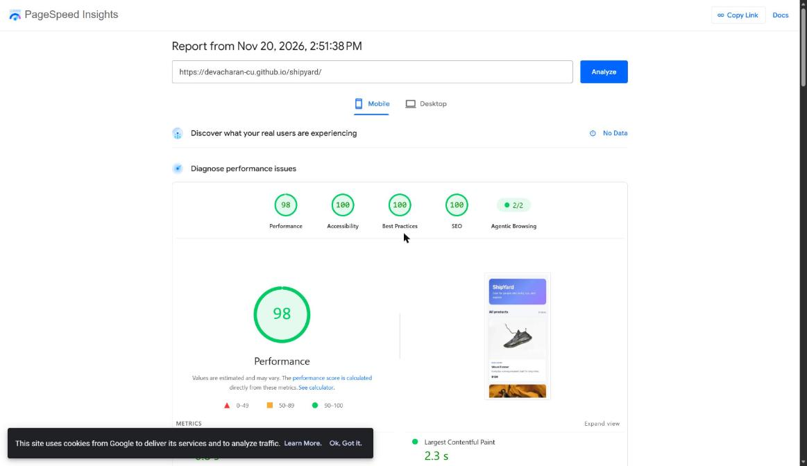

# ShipYard

A product-catalog storefront built with Next.js + TypeScript.

- **Live site:** https://devacharan-cu.github.io/shipyard/
- **Lighthouse Performance: 98 (mobile)**, with Accessibility 100, Best Practices 100, SEO 100 ([PageSpeed Insights report](https://pagespeed.web.dev/analysis/https-devacharan-cu-github-io-shipyard/y4qcin6kil?form_factor=mobile))



## Run locally

```bash
npm install
npm run dev
```

Then open http://localhost:3000.

To build the static site that gets deployed:

```bash
npm run build   # writes the static export to out/ (served under /shipyard)
```

## What it does

Browse a product grid and open a detail page for each product.

- **Catalog:** typed product data (`app/data/products.ts`), a reusable `ProductCard`, a responsive CSS-grid home page, and a dynamic `/products/[id]` route pre-built with `generateStaticParams`.
- **Optimized:** `next/image` with explicit sizes (no layout shift), self-hosted Inter via `next/font`, a heavy Reviews panel lazy-loaded with `next/dynamic`, compressed WebP photos, and per-page metadata (`metadata` + `generateMetadata`).
- **Resilient:** `app/loading.tsx`, `app/error.tsx` (with a retry button) and `app/not-found.tsx` for unknown products.

## Deployment

Pushes are built and published to GitHub Pages by the GitHub Actions workflow in `.github/workflows/deploy.yml`. It runs `npm ci` and `npm run build`, then uploads the `out/` folder. `next.config.ts` uses `output: "export"`, `basePath: "/shipyard"` and `images: { unoptimized: true }` so the static site works under the repo path.

## Lighthouse: measure → fix → re-measure

| Run | Performance (mobile) | LCP | Top opportunity |
| --- | --- | --- | --- |
| Before | 93 | 3.2 s | Improve image delivery (est. 160 KiB) |
| After converting photos to WebP | **98** | 2.3 s | Improve image delivery (est. 29 KiB) |
